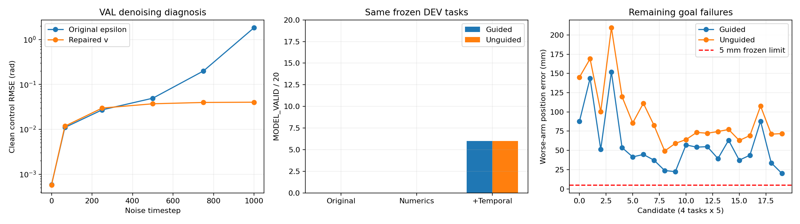

# V7.1 Diffusion 数值修复与冻结 DEV smoke 复核

日期：2026-10-15。分支：`v7.1-lightweight-free-floating-prior`；修复基点：`f2284b64f709aa0417633fb6e9506b5d38fa0e30`。

已实际修复训练目标、高噪声重建、引导后的 DDIM 一致性和浮点边界问题，并完成两轮同预算 smoke。**最终仍为结构先验基线 1/4、无引导 Diffusion 0/4、去噪内引导 Diffusion 0/4；Diffusion 规划收益 NOT_ESTABLISHED。** 数值稳定改善和 MODEL_VALID 增加不能替代冻结目标与真实执行验收。

## 1. 原因与实现

### 高噪声将 epsilon 预测误差放大

令 `a = sqrt(alpha_bar)`、`s = sqrt(1-alpha_bar)`，原 epsilon 参数化采用 `x0 = (xt - s*epsilon)/a`。因此 epsilon 误差向 clean estimate 的增益为 `s/a`。在 timestep 999，`alpha_bar = 4.035830716e-5`，增益 **157.407**。原 checkpoint 的 VAL epsilon MSE 仅约 0.05405，但对应 clean normalized MSE 为 1339.26，物理控制点 RMSE **1.826575 rad**。只看噪声 MSE 会掩盖失真。

`ff_prior/diffusion.py` 现训练 `v = a*epsilon - s*x0`，采样用 `x0 = a*xt - s*v`、`epsilon = s*xt + a*v`。在固定 xt 下，v 误差进入 x0 的系数绝对值不超过 1。仍使用原 1000 步线性 beta schedule、网络规模、TRAIN/VAL、种子、200 次更新及 VAL checkpoint 选择；未增加训练预算。旧 epsilon checkpoint 仍能按原参数化读取，新 checkpoint 显式绑定参数化、schedule 和精度合同。

同一 VAL 噪声诊断下，timestep 999 的控制点 RMSE 降至 **0.040173 rad**，timestep 750 从约 0.199589 降至 0.039625 rad。这是去噪误差改善，不能换算为末端任务成功。新旧 loss 预测对象不同，不能把原 epsilon MSE 与新 v MSE 直接作训练收益比较。v 参数化相关背景见 [Salimans 与 Ho，Progressive Distillation](https://arxiv.org/abs/2202.00512)；本次没有做蒸馏。

### DDIM 更新与浮点边界

原无引导 DDIM 的基本公式及 timestep 数量没有发现错误；主问题是高噪声下的预测误差。引导改变 x0 后，原实现仍沿用修改前 epsilon。本次明确采用同一 xt 分解：在 clean projection 或引导后，重新计算 `epsilon = (xt - a*x0)/s`，再计算 `x_next = sqrt(alpha_next)*x0 + sqrt(1-alpha_next)*epsilon`。每个候选仍恰好 **16 次网络调用**，引导仅在第 14、15 次迭代（从 0 起）内发生。保存每步分解残差，本次全部小于 `1e-12`。

原 guided 候选在边界投影后经历 float32 归一化/反归一化，20 个候选的最大域外偏差为约 **1.60e-8–9.07e-8 rad**。本次网络保持 float32，采样状态与仿射变换使用 float64；最终直接返回引导产生的 float64 物理控制点，避免再次往返变换。**没有为域检查加入容差，也没有放宽物理边界。** 原无引导还存在 0.685–15.019 rad 的大越界，不能全部归咎于浮点舍入。

### 数值稳定后仍有时间结构失真

第一轮数值修复使两种 Diffusion 各 20 个候选都通过构型域、native 范围和运动限值，但全部仍被几何细化门槛拒绝。原 guided 加速度限值比为 5.89–13.00，unguided 为 6.37–33.17，说明独立控制点噪声还破坏了原平滑先验的时间结构。

第二轮增加 `ff_prior/clean_prior.py`：只从 **150 个 TRAIN 样本**的 `(Z-q_initial)` 拟合 19 维时间方向 SVD 子空间，固定保留能量 0.9999999，得到 rank 5，TRAIN 最大重建误差约 `3.12e-16 rad`。在每个 DDIM 步内投影 clean estimate，并重算 epsilon；不投影 noisy state。公开初态、TRAIN 样本 ID/数组哈希、投影矩阵、robot/initial 哈希均绑定 checkpoint。它没有使用 DEV 见证、未来基座状态或私有末端关节构型，也不是物理验证器。

两轮新训练的选中权重哈希相同：`1d24238d6f313ec7746ddf3796ed747ba304912ca53609c47c9fb2ce8f907d93`。因此两轮间候选变化来自时间结构投影，不是追加训练。投影可能限制可表达路径族；它只是当前 TRAIN 分布上的开发先验，不代表通用可达性。

## 2. 同冻结任务、同候选预算的实测

原结果 `artifacts/v7_1/smoke_002` 原样保留。两轮新结果分别保存在 `smoke_diffusion_repair_001` 和 `smoke_diffusion_repair_002`，没有覆盖原运行。

每轮均为相同 4 个冻结 DEV 任务、3 种方法、每任务 5 个候选；Diffusion 每候选 16 次网络调用，guided 每候选 2 次引导、每次 8 个中心差分方向。种子和预先规定的任务分母完全一致。任务列表哈希：`1a9bb9b140b3c7b86ef53758f242b315ee1af76904fc97c656b73158d23dde5e`。候选先经过模型及冻结目标门槛，再选择最多一个进行真实执行；未靠反复执行挑成功样本。

| 运行 | 结构先验真实执行成功 | 无引导 MODEL_VALID | 无引导真实执行成功 | 引导 MODEL_VALID | 引导真实执行成功 |
|---|---:|---:|---:|---:|---:|
| 原 smoke_002 | 1/4 | 0/20 | 0/4 | 0/20 | 0/4 |
| repair_001：数值修复 | 1/4 | 0/20 | 0/4 | 0/20 | 0/4 |
| repair_002：再加 TRAIN 时间投影 | 1/4 | 6/20 | 0/4 | 6/20 | 0/4 |

最终两种 Diffusion 的构型域、native 范围及运动限值各 **20/20 通过**；各有 **14/20 几何细化失败**，各 **0/20 满足冻结双末端目标**。它们没有候选进入真实力矩执行，不能描述成“执行了四次但失败”。20 个候选的较差一臂位置误差：guided **20.12–152.00 mm**，unguided **49.25–209.28 mm**，门槛仍为 **5 mm**，同时还要求旋转误差不超过 1 度。即使 6 个 MODEL_VALID 候选也没有达到冻结目标。

最终路径最大几何采样位移 guided 为 1.124–3.876 mm，unguided 为 1.138–3.679 mm；独立细化要求仍为 2 mm，最多 512 区间。未提高上限或放宽该门槛以通过候选。最终加速度限值比约 0.048–0.116，不再接近或超过 1。

高噪声 VAL 条件打乱后 RMSE 为 0.065952 rad，高于正确条件的 0.040173 rad，表明网络学习了部分条件信息；但实测末端误差说明条件精度仍不足。有限数据、训练步数、19×17 输出的冗余时间方向和少步采样共同构成合理解释；本次没有足够独立消融将剩余失败精确归因给某一因素。不能据此声称“只是再训练就一定成功”。

本轮数据属于反复查看同一 DEV 的工程调试，不能作为全新留出测试或统计收益证明。没有继续针对这 4 个任务调整来凑成功率。



## 3. 参考仓库核对与数据集完整性

只读检查用户指定仓库，固定到 commit `900d781ba63f0123dff95e49a76d51cb49a74803`。未运行它的大规模生成器、未安装其环境，也没有把其示例或结果算作本项目实验。

| 对照点 | 参考仓库代码 | 本项目判断 |
|---|---|---|
| 监督任务 | 随机起终关节构型，每对 5 个 mode；线性与 sextic 扰动生成轨迹 | 它已知终端关节构型；本项目只公开双臂世界目标，必须求解路径相关的自由漂浮耦合问题，难度与条件信息不同 |
| 生成失败 | 有界尝试后可回退线性轨迹；初始生成主要检查离散关节范围 | 5 个 mode 不自动等于 5 条不同且物理可执行轨迹；本项目也不能把 5 个 proposal 类型当作 strict_multimodal 成功 |
| 后处理 | 独立 refine 阶段加入 tendon stroke/velocity/acceleration、关节及平滑约束，并重新评估；open-space 配置关闭外部障碍 | 可借鉴逐样本质量统计和执行器约束，但不能冒充本项目的 67 通道真实力矩、全机几何及独立重放 |
| 采样端点 | sampler 直接固定已知起终构型的前后 4 个控制点 | 不得将本项目私有终态写入 sampler；本项目 decoder 的前后 3 个相等控制点合同保持不变 |
| 动力学 | 几何运动学链默认初始变换为单位阵，也允许传入 T_init | 所检查实现没有建立本项目的自由基座动量耦合传播；不能用它替换自由漂浮物理检查 |
| 训练/采样量 | 训练脚本默认 500 epochs、batch 256；生成脚本默认 num_pairs=100000；proposed 请求 DDIM 60 | 这些是配置默认值，不是已验证数据量或效果。其整除步长实现 `1000//60=16`，实际 range 有 63 步；不能当成本轮 16 次调用的等预算基线 |
| 数据隔离 | pair-level split 有利于同任务模式隔离；无外部统计文件时先收集数据统计再 split | 全集归一化存在统计泄漏风险，不能照搬；本项目 scaler 和时间 SVD 均只用 TRAIN |

以上逐项来源：[生成器](https://github.com/zhanglooong/htdcr-actuator-aware-diffusion-planning/blob/900d781ba63f0123dff95e49a76d51cb49a74803/scripts/training/generate_training_data.py)、[refine](https://github.com/zhanglooong/htdcr-actuator-aware-diffusion-planning/blob/900d781ba63f0123dff95e49a76d51cb49a74803/scripts/training/refine_training_data.py)、[planner 公共条件](https://github.com/zhanglooong/htdcr-actuator-aware-diffusion-planning/blob/900d781ba63f0123dff95e49a76d51cb49a74803/src/htdcr_planning/planning/diffusion_planner.py)、[guided sampler 端点及 DDIM](https://github.com/zhanglooong/htdcr-actuator-aware-diffusion-planning/blob/900d781ba63f0123dff95e49a76d51cb49a74803/src/htdcr_planning/interface/guided_sampler.py)、[kinematics](https://github.com/zhanglooong/htdcr-actuator-aware-diffusion-planning/blob/900d781ba63f0123dff95e49a76d51cb49a74803/src/htdcr_planning/robot_model/kinematics.py)、[训练入口](https://github.com/zhanglooong/htdcr-actuator-aware-diffusion-planning/blob/900d781ba63f0123dff95e49a76d51cb49a74803/scripts/training/train_proposed.py)、[数据加载](https://github.com/zhanglooong/htdcr-actuator-aware-diffusion-planning/blob/900d781ba63f0123dff95e49a76d51cb49a74803/src/htdcr_planning/dataset/dataloaderConfig.py)、[proposed 配置](https://github.com/zhanglooong/htdcr-actuator-aware-diffusion-planning/blob/900d781ba63f0123dff95e49a76d51cb49a74803/configs/method/proposed.yaml)。其 [DiffusionProcess](https://github.com/zhanglooong/htdcr-actuator-aware-diffusion-planning/blob/900d781ba63f0123dff95e49a76d51cb49a74803/src/htdcr_planning/models/DiffusionProcess.py) 同样使用 epsilon 预测和除以 sqrt(alpha_bar) 的重建，不能仅凭参考项目存在便认定能解决本次高噪声问题。

**本项目数据生成工程链已可用，但当前 smoke 数据集不完善，尚不足以支撑规划收益结论。** 本轮只读核对 TRAIN/VAL/DEV 的 379 条记录：TRAIN 150/30 个 family，VAL 30/6，DEV 199/40；只有 1 个完整初态，全部时长 10 s，无外部障碍 scene family，379 个不同任务哈希，同一精确冻结目标的样本数最多 1。没有读取 TEST 数组。五类 proposal 是不同前向派生目标的来源标签，符合主先验库取消“五条同目标”的合同，但并未完成 strict_multimodal 子集。

分组隔离、TRAIN-only 归一化、完整初态、17→67、耦合前向派生目标、全机模型门槛及选定真实抽查均有工程证据。其不足是初态/场景/时长覆盖狭窄，真正独立 TRAIN family 只有 30，世界目标条件密度不足；模型先验的标签自洽不代表从世界目标逆向规划已经学会。全量先验的参考力矩可行性仍是 NOT_EVALUATED，旧抽查通过不能升级未执行样本。这些是证据与覆盖边界，不应用放宽约束来掩盖。

后续可在单独冻结的开发协议中验证公开目标残差条件、在 TRAIN 上选择低维时间表示、增加目标覆盖与执行器质量诊断；需要重新定义实验预算并保留失败分母。本次没有执行这些扩展，没有启动 pilot、strict 子集或 TEST。

## 4. 物理合同、开销与复现

非穿透阈值始终为用户明确要求的 **>=0 m**。17→67 映射、完整初态、自由基座、全机 pair policy、双末端 5 mm/1 度、0.5 s hold、30 s deadline、真实力矩与独立重放均未改变。物理模型哈希 `76edfae2ce103d0191dbbf7911abfc5d3de0bedd06725ffb86361a596830ca19`；初态 ID `9eb21ed3fa3f7d5fd475de862d75adce52e582f5ad86911b09330c45e0c01c7b`。

| 新增工作 | repair_001 | repair_002 |
|---|---:|---:|
| 实际 optimizer updates | 200 | 200 |
| 训练 wall / CPU 秒 | 7.778 / 9.859 | 8.385 / 10.375 |
| benchmark wall / CPU 秒 | 117.653 / 115.734 | 118.710 / 116.938 |
| 候选总数 | 60 | 60 |
| Diffusion 网络调用总数 | 640 | 640 |
| 真实执行 / 独立重放 | 1 / 1 | 1 / 1 |
| mj_step（含重放） | 10500 | 10500 |

两轮训练及 benchmark 记录合计约 **252.525 wall 秒 / 252.906 CPU 秒**；不是整个开发耗时，诊断、测试、环境初始化和报告另计。新增两次真实执行都来自结构基线，独立重放最大状态误差均为 0。没有重跑旧 24 条数据抽查；它们仅是历史数据质量证据。两轮是同四个任务的重复调试，不是八个独立任务。

最终测试 **48/48 通过**（JUnit suite 约 20.75 s），覆盖高噪声解析误差、DDIM oracle/调用数、引导边界、TRAIN 时间投影/哈希、checkpoint 合同以及既有真实动力学、碰撞反例和独立重放。测试内物理工作不计入上述 benchmark 次数。实际运行 resume 后 attempts/calls/completed 未增加，未重复候选或真实执行。

本地两轮完整产物合计约 72.8 MB，包括 checkpoint 和 native trace；Git 只提交紧凑 JSON、测试报告、图与代码快照，不提交模型权重或大型数据。两个目录的 `executed_source.zip` 分别保存当轮精确 Python 实现；源码哈希绑定在 run manifest。旧结果和旧代码快照保持原样。

```powershell
# 从仓库根目录，原数据只读；另选一个未使用输出目录才能新跑。
.venv\Scripts\python.exe -m ff_prior.recheck --source artifacts/v7_1/smoke_002 --output artifacts/v7_1/smoke_diffusion_repair_003 --dry-run
.venv\Scripts\python.exe -m ff_prior.recheck --source artifacts/v7_1/smoke_002 --output artifacts/v7_1/smoke_diffusion_repair_003
# 本次实际已验证过的恢复入口；003 只是命令示例，未运行。
.venv\Scripts\python.exe -m ff_prior.recheck --source artifacts/v7_1/smoke_002 --output artifacts/v7_1/smoke_diffusion_repair_002 --resume
.venv\Scripts\python.exe -m pytest ff_prior/tests -q --junitxml=artifacts/v7_1/diffusion_repair/tests_final.xml
.venv\Scripts\python.exe -m ff_prior.evidence.analyze_recheck
```

`recheck` 是 smoke-only 独立入口，只链接旧 TRAIN/VAL 数组，使用冻结任务，不重新生成或选择 DEV，也不提供 pilot/TEST 开关。其 `run.config` 保留原配置以固定物理协议；**有效训练参数化由 `identity.diffusion_contract` 与 checkpoint metadata 指定，时间投影由 `identity.clean_prior_mode` 指定**。当前 proposed YAML 已同步为 v 预测和 TRAIN 时间投影；没有回写旧运行配置。更换实现后旧运行的通用 resume 会拒绝源码身份不匹配；复现旧实现应在独立目录使用当轮 source archive。

核对原始明细见 `ff_prior/evidence/diffusion_repair/`：`comparison_audit.json`、三个 `diagnosis_*.json`、`dataset_audit.json`、每轮 `planning.json`/execution report、训练历史、`tests_final.xml` 与 SHA256 `manifest.json`。审计明确区分：软件回归通过；先验样本存在 MODEL_VALID；新增基线执行通过；两种 Diffusion 执行收益未成立。main、旧分支、原未提交补丁和旧 expert worktree 保留，未推送、未停止旧任务。
