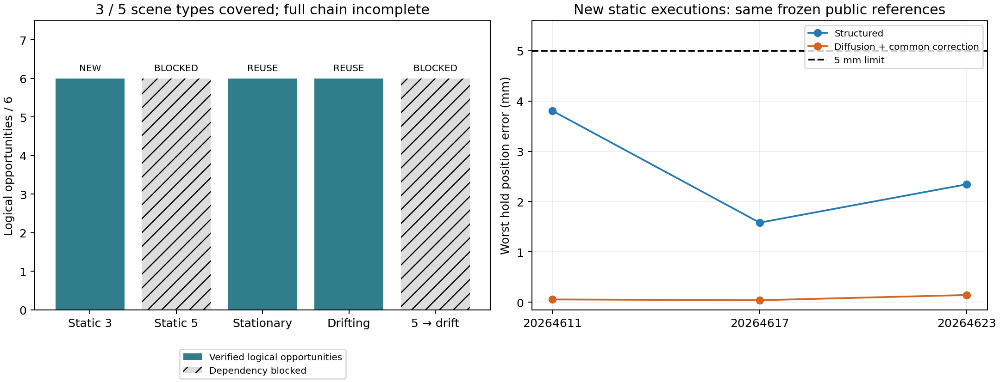

# P4 固定开发验收结果：局部链路通过，完整工程仍有两项缺口

2026-10-22。运行`artifacts/v7_1/fullchain_acceptance_001`，源码提交`370a2041`；worker用时219.797秒，终态`FINISHED_WITH_BLOCKED_ITEMS`。

**6条三障碍新执行及完整状态独立重放全部通过；12个动态逻辑记录准确复用，另12个五障碍及连续组合机会保持BLOCKED。** 当前覆盖3/5类场景、18/30个逻辑机会，尚未实现原五障碍公开规划和五障碍接近→漂移追踪连续组合。不能将已有局部成果改称完整目标完成，也不能把未执行的12个机会称为12次执行失败。

## 实际运行与证据分级

|场景|确定性系统|Diffusion系统|本轮证据来源|
|---|---:|---:|---|
|原三障碍预抓捕接近|3/3|3/3|6次新原生67力矩执行及独立重放|
|原五障碍预抓捕接近|0/3，BLOCKED|0/3，BLOCKED|前置路径几何门未过，未执行|
|原静止卫星＋七航点|3/3|3/3|6个准确历史逻辑记录|
|原漂移卫星＋七航点|3/3|3/3|6个准确历史逻辑记录|
|五障碍接近→漂移连续组合|0/3，BLOCKED|0/3，BLOCKED|无合格接近结束状态，未冻结实际连续执行任务|

两系统各9/15逻辑机会有合格证据，另6/15依赖阻塞；这不是15次独立实际试验的成功率。动态12条逻辑记录对应8次历史独特执行，4条确定性记录共享同一条件的已有控制序列。本轮新增实际执行只有6次，历史8次不计为新成功。

静态参考来自`static_fullchain_002`原公开输入规划的u00–u05，预选候选依序2/4/4/2/1/3；没有重新挑选更好的候选，没有读取07已知答案作为部署。此次检验的是最终执行接口对这6条固定参考的执行资格，**不是6条新采样或新自主规划**。

最终接口增加显式完整INTEGRATION重放门，旧三障碍执行身份不能直接替代，所以实施新执行。动态则仅复用`temporal_learning_001`准确源码、模型、codec、任务、初态、参考和控制绑定及已有完整状态证据，不重训、不重放或重审旧物理。两个场景的3种子是采样噪声；确定性输出没有独立随机重复。

## 六条新执行的世界精度与避障

每条27秒参考＋0.5秒终点保持，2ms原生步长。下表误差取终点保持期间双臂中的较大值；不能把静态接近过程相对最终位姿的距离当作追踪误差。

|种子|方法|位置均值 / P95 / 最坏（mm）|姿态最坏（°）|全程最小间隙（mm）|
|---|---|---:|---:|---:|
|20264611|结构＋共同修正|3.80458 / 3.80481 / 3.80481|0.211254|8.46307|
|20264611|Diffusion＋共同修正|0.05456 / 0.05461 / 0.05461|0.006549|1.54303|
|20264617|结构＋共同修正|1.58100 / 1.58150 / 1.58156|0.130838|0.94224|
|20264617|Diffusion＋共同修正|0.03862 / 0.03888 / 0.03893|0.003310|0.69252|
|20264623|结构＋共同修正|2.34416 / 2.34461 / 2.34467|0.246484|0.58366|
|20264623|Diffusion＋共同修正|0.14304 / 0.14316 / 0.14317|0.020667|0.41475|

六条全部满足原世界5mm/1°、仅不穿透、关节/导数/力矩/动量/跟踪等门。最大几何步长约0.2082mm，小于原2mm门。每条13750原生步＋13750独立重放步，总82500＋82500＝165000步；六条完整836维INTEGRATION重放误差均为0，qpos/qvel/act/time/warmstart误差也为0。没有逐步复制实际状态来实现重放。



提供[实际记录的双末端路径查看器](recorded_endpoints.html)，支持逐帧和XY/XZ/YZ投影；数据每100ms来自保存的原生轨迹，附源文件与SHA256。它不是全机碰撞几何演示；资格依据完整原始几何与状态审计。

## Diffusion收益的边界

静态三障碍中，Diffusion系统三对保持位置误差均较小，最坏误差差值分别−3.7502、−1.5426、−2.2015mm；同时最小间隙分别少6.9200、0.2497、0.1689mm。两法执行均3/3，并无成功率优势。这些是固定开发参考和共同323修正后的系统差异，不是裸网络独立绕行收益，不是新训练后的改善，也不足以证明总体优势或未见泛化。

精确复用的动态结果同样有边界：静止场景确定性最坏位置0.33274mm，Diffusion为0.60854–0.75038mm；漂移场景确定性1.03450mm，Diffusion为0.71739–0.83198mm。两个场景各方法均通过，共同世界反馈负责目标追踪。此前无世界反馈VAL两法各0/4的失败仍保留，本轮没有重做或覆盖。静态网络65维条件和动态时序网络是不同组件，不能合并宣称一个统一自主网络已解决所有任务。

本轮没有新训练、新提案、新数据或扩库；科学收益仍须与工程可用性分开。

## 具体缺口与停止局部反复的理由

1. 原五障碍公开规划仍无MODEL_VALID路径。上一轮30/30目标种子达门，但6完整验证仍穿透16.7–35.4mm；终点已靠近物理门边界，局部修正停止。该前置负结果不由本轮三障碍执行覆盖。
2. 五障碍连续组合缺少合法的起始衔接路径与真实连续结束状态，因此尚未冻结执行task_hash，更没有连续组合原生轨迹。`PhaseSession`保证同live model/data、时间与完整状态不被重置的接口已有软件检查；软件检查不是实际五障碍组合通过。
3. 既定路线只允许一次同瓶颈机制修复，已经完成。继续扫局部步长、rank、损失权重或重复训练既不在当前协议内，也没有本轮证据支持。下一种全局绕行机制需另立有界协议和授权，不能借改阶段名重复追加。

原工程完成门保持：五类场景均有真实合格记录，尤其五障碍接近及其连续组合。当前只支持局部系统组件可用。扩库、TEST、硬件或接触捕获仍未启动。

## 身份、审计、恢复与交付

启动前37项软件/身份/资源检查通过，冻结125份新依赖源码和589份输入。准确复现须使用`executed_source.zip`、manifest及绑定的历史组件归档；生产Git提交不代替包含用户既有修改的执行归档。旧模型、结果和用户修改均保留。

本轮实际输出953761239字节，预算账本无inflight，165000步等于冻结新执行上限；没有途中追加预算。主统计仅读取保存数组，独立审查另在`paper/review-traces/experiment-result-to-claim/20261022_fullchain_acceptance_run01/`保存新证据检查及裁决。2119/2119项新证据核对通过；整体partial、confidence high；完整C1为no，完整工程主张未接受；C2稳定正向收益no。缺PAPER_CLAIM_AUDIT，论文主张保持provisional。它不重复历史物理实验，也不将纸面检查视作新执行。

完成resume只核一次：返回`NO_WORK_ALREADY_COMPLETE`，前后133文件清单/hash不变，0新物理步。不得再次执行本轮或历史resume。原`FINISHED_WITH_BLOCKED_ITEMS`终态保持。

当前分析与逐条证据：`evidence/statistics.json`、`unit_metrics.csv`、`native_endpoint_paths.json`、`completed_resume.json`；所有原生状态、控制、几何扫描、独立重放保存在原run，不上传大数据。独立主张最终裁决以review目录`verdict.json`为准。

```powershell
.\ff_prior_fullchain\job.ps1 status
.\ff_prior_fullchain\job.ps1 next
.\ff_prior_fullchain\job.ps1 report
```

软件/最终接口完成与6条新EXECUTION_VERIFIED已经有证据；完整五场景工程和稳定Diffusion相对优势尚未达成，长期目标不能标记complete。
