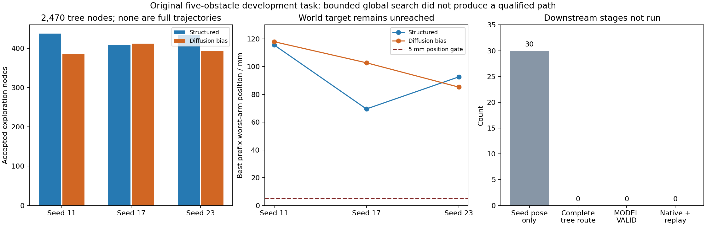

# 原五障碍全局绕行验证：运行结束，完整路线仍未建立

日期：2026-10-22，Asia/Shanghai。运行 `artifacts/v7_1/global_bypass_001`，生产源码 `c22e79eb877abb02c705508126bf3dce7e8be7ac`。本报告来自本轮保存的原始状态、树边、连接迭代和账本；分析没有新增物理试验。

## 结论

本轮有界验证已执行结束，worker为 `FINISHED_WITH_BLOCKED_ITEMS`，耗时 **1079.469秒（约18分钟）**。两种方法均未构造出到达原五障碍世界目标的完整树路线：**各0/15合格候选，实际执行0次、重放0次**。323转换、局部精修和真实执行都因前置路线缺失而未运行，不能把这些未运行阶段写成已经测得失败。

分段携带自由基座的传播检查通过，真实搜索也产生了大量无穿透的局部树边。但“局部树边可行”没有闭合成“避障且到达指定世界目标”。**当前直接瓶颈在世界目标连接与树扩展的组织方式，不是新增数据或网络训练。** 本轮没有证据支持稳定的Diffusion相对优势，也不能据此证明原五障碍无解。

软件完成、传播一致性、模型轨迹资格、力矩执行、Diffusion收益分别为：**已运行 / 有限检查通过 / 0条 / 未运行 / 未建立**。长期工程目标仍缺原五障碍合格路径与五障碍接近→动态追踪连续组合。旧三障碍和动态组件结果保留，不作为本轮新成功。



## 1. 实际范围与分母

原 `capture_5_obstacles`、原完整初态、原27秒、原世界目标保持；task hash为 `e66384242aaacf174ab1d7e642f0ba84b55ea580ab1b62951988409c75115496`。三种子20264611/17/23，两种方法各五提案。真实15条Diffusion提案各16步采样，旧102维模型经零细节头产生323输出；没有新训练、数据补充、扩库或TEST。

|指标|结构几何提案＋同一搜索器|Diffusion提案偏置＋同一搜索器|
|---|---:|---:|
|冻结候选|15|15|
|目标初始化位姿达门（尚未验证避障）|15/15|15/15|
|前向扩展尝试|2451|2465|
|插入的非根树节点|1280|1190|
|留有迭代证据的目标连接会话|24|24|
|连接迭代 / 接受的更新|75 / 51|85 / 62|
|会话最后一次未找到可接受步|24/24|23/24|
|完整树路线 / 合格完整轨迹|0/15 / 0/15|0/15 / 0/15|
|实际执行 / 实际重放|0 / 0|0 / 0|
|冻结执行机会被阻塞|3/3|3/3|
|实际耦合调用（不含共同M0）|8273|8288|

48会话是**保存了迭代记录的会话数**，并非声称代码的全部连接函数调用都有独立开始/退出记录。0/3表示未产生可执行候选导致的计划机会阻塞，不能写成“已执行3次、全部失败”。

每个树节点保存17关节、完整模型INTEGRATION状态、自由基座、全qpos/qvel、已用时间与父指针。树边采用解析rest-to-rest五次曲线；零端点速度由曲线导数产生，没有在真实执行中清零。全程没有原生执行。

## 2. 传播检查支持什么

M0固定两段小幅模型轨迹，分段256+256与整体512区间比较。8项检查全部通过；保存数组重算的全qpos和qvel最大差均为0，双末端位姿差为0，父节点状态及时间连续，基座实际发生非零变化。两段最大动量残差约8.13e-17和2.54e-17。

这支持本实现对**这条固定小幅静态零动量路径**的父状态连续传播一致性，不等于整个动力学模型已被全面验证，也不等于本轮有合格避障轨迹或原生力矩执行。树边只按保存的数值残差和几何筛选记录审计；本次分析没有重新做物理传播。

## 3. 卡在哪里

### 3.1 初始化能命中世界目标，但不等于存在合格连接

目标初始化后的双臂最大位置误差，结构方法均值0.0341mm、最坏0.0398mm；Diffusion均值0.5144mm、最坏1.8939mm。对应最坏姿态分别0.00170°和0.08287°，都在位姿门内。这是**共同非线性目标修正后的模型预测**，不是裸网络命中，也未证明全路径避障。

进入树搜索后，节点是在避免穿透的约束下寻找另一条关节路径。自由基座姿态随前缀变化，不能只把初始化的末端关节向量当成对所有前缀都通用的世界目标解。

### 3.2 树有局部进展，目标连接仍遇到碰撞

共保存12013次带几何扫描的边传播：2631次边筛选接受，7138次尚需更密区间满足2mm步长，2244次发现穿透；保存的数值门失败数为0。2631次接受包含2470个探索节点、48次连接起始保持边和113次目标连接接受更新，不能全部称为新树节点。

目标连接共160次迭代、326个线搜索提议；113个通过边检查且被接受，213个边检查未通过。47/48会话最后三档提议均未通过边检查。独立审查按父状态hash和重建的目标关节匹配保存边，精确核出这213次拒绝中：**204次穿透而提前终止，9次完整传播到最高512区间仍超2mm几何步长**；没有未匹配记录、数值失败或其他拒绝类别。已实际传播且穿透的最常见对为 `v7_capture_3 / collision_0069`（566次，包含探索边），其次为 `v7_capture_2 / collision_0072`（447次）。

这直接支持“目标连接主要受碰撞阻断”。日志未显式链接试探到边ID，未来应直接保存链接及所有预传播拒绝原因，减少重建歧义；本run的这213次已经由保存记录完整匹配，不把一般记录风险冒充本轮缺失。

### 3.3 目标连接的有用进展没有变成可继续扩展的节点

冻结实现的 `goal_connect` 从当前树节点向最终目标做局部修正；只有Q≤0.7才返回完整路线，否则返回None。已接受但未达终门的113次改进只保存在连接记录里，没有进入探索树。

更关键的是，这些连接边的时长是**27秒减去当前节点时间**：每次接受的连接终点都已用完剩余时间。不能简单把接受点插回树后继续前进，否则会超出原27秒合同。下一种机制若要利用这些进展，必须把目标定向连接改成可继续的短时扩展，并按父状态、时间及原运动门实际传播。这是需要新冻结协议的方法改变，不能当作本轮报告脚本修补后追认成功。

### 3.4 搜索距离没有对齐世界终点验收

父节点选择和 `best_node` 使用关节空间距离，`best_node`不按双臂世界误差选择。只读重算发现，**22/30棵树的该节点并不是树内世界Q最小的节点**。此差异说明当前启发式与任务验收不一致；不能据此断言换排序后一定成功。

以下是各单元所有已插入节点中，世界Q最小节点的双臂最大位置误差。它们只是未完成路径的前缀端点，不是最终执行误差。

|种子|结构方法最佳前缀位置误差|Diffusion方法最佳前缀位置误差|
|---|---:|---:|
|20264611|115.589mm|117.911mm|
|20264617|69.482mm|102.739mm|
|20264623|92.571mm|85.228mm|

最接近的已插入节点仍距5mm门很远，姿态也未同时达门。所有已接受目标连接中，最好的Q仍为约15.41；因此没有证据表明本轮仅被内部0.7余量门挡住，不能靠把它改到1.0就宣称已能成功。

### 3.5 本轮先用尽的是候选搜索额度

30棵树都以 `SEARCH_BUDGET_RESERVED` 结束。500次/候选包含不同网格重算和端点有限差分，不能理解为500个有效新增节点。每棵树实际平均约163.9次探索尝试、82.3个新节点；没有触发节点数或尝试数上限。

全部已插入节点最长只到8.410秒，时间预留拒绝为0，故**本轮没有证据把失败归因于原27秒过短**。总计16564/36000耦合（约46.01%）、2814080个预留模型积分区间、0原生步；未触发总6小时或磁盘上限。其余额度主要属于未进入的转换、精修、认证、执行及保留份额，冻结协议禁止事后挪给搜索。记录积分数是预留区间总数，碰撞边可提前终止，不应全部称为实际积分步。

## 4. 两种方法和Diffusion收益

两法合格完整路线均0/15，没有新增执行对照，成功率优势未建立。Diffusion较多的连接接受更新（62对51）没有转化为完整路线；结构法新增树节点更多（1280对1190）。各种子最佳前缀误差有升有降，不支持稳定优势。

15个候选的“最佳树前缀”最大位置误差分布如下，保留全部候选分母；其含义仅是搜索诊断。

|方法|均值|中位数|P95|最坏|
|---|---:|---:|---:|---:|
|结构|148.347mm|159.388mm|197.006mm|199.656mm|
|Diffusion偏置|143.592mm|145.633mm|192.692mm|203.794mm|

均值略低但最坏值更差，且同一固定任务的相关候选不能当成独立跨任务泛化样本。旧65维模型没有环境条件，未接受本轮训练；当前结果不能裁决“MLP必然不如Transformer”或“扩库会改善”。本轮也没有新的无物理引导完整模型资格诊断，不能把目标修正后的初始化位姿归为裸模型能力。

## 5. 证据、审查与恢复安全

原始worker审计2734/2734通过；这表示保存证据/身份/账本核对通过，不表示路径任务通过。独立审查另见本报告末尾，不能用原审计替代独立claim裁决。

完成resume已且仅已调用一次，返回 `NO_WORK_ALREADY_COMPLETE`；前后 **24735个文件的完整清单、大小及SHA256均未变化**。原始文件共742231479字节，约0.691GiB。无新增物理调用。请勿再次resume或重审旧run。

主要证据：本包 `evidence/statistics.json`、`candidate_statistics.json`、`goal_connection_statistics.json`、`unit_metrics.csv`、`completed_resume.json`，以及原run的 `run.json`、`executed_source.zip`、`m0/`、`units/*/candidates/*/tree/`、`ledger.json`、`budget.json`、`independent_verification.json`。完整hash清单保存在本机 `evidence/core_manifest.json`；Git精简证据索引提供其hash。

仅源归档和输入manifest能准确复现执行依赖；用户原有未提交代码保持原状，不能把生产Git提交单独称为全部源码身份。树边没有保存全部几何中心/旋转和所有有限差分状态，独立只读审查的能力受此限制。

## 6. 下一阶段判断

**暂不训练、扩库或TEST；先解决规划器的可继续目标定向扩展。** 这里缺的是一条避障且到达目标的公开可复现完整路径。用未完成树边增加训练数据，或用新模型替换旧模型，都不能补上这个验收缺口。

建议下一次若获得独立范围授权，只改变一个机制：将“最终27秒连接成功才返回”替换为“短时目标定向扩展，保留有用且无碰撞的中间状态”，父节点选择同时看真实世界残差和剩余可行时间；把所有预传播拒绝原因、有限差分中心/扰动状态、实际查询分账一并记录。先小规模验证进展能成为可继续节点，再同原任务/种子/候选预算验证，不改世界目标、原时长、仅不穿透或其他物理门。

这是有依据的后续机制假说，尚未实现或启动，不能承诺其一定能绕行成功。新试验预算不能从本轮“剩余额度”自行挪用。没有五障碍合格实际终态，连续组合合同和执行仍BLOCKED。现有源码和所有负结果保留。

```powershell
.\ff_prior_global_bypass\job.ps1 status
.\ff_prior_global_bypass\job.ps1 report
.\ff_prior_fullchain\job.ps1 status
```

## 独立审查

本轮按 `experiment-result-to-claim` 委派了全新独立review。完整工程主张C1为 **no/high**，Diffusion相对收益C2为 **no/high**；这里的high指“本轮没有支持相应主张”的判断置信度，不是证明任务无解或两法等价。

独立审查完成79558项保存数组/身份/代数检查及33项补充检查，无检查失败；另以240次神经前向重建15条完整16步Diffusion提案，保存的network_raw逐元素一致。所有4916次树抽样/父节点选择也由冻结随机流重建，目标数组最大差为0。审查没有新增物理传播、优化器更新或resume调用。

有限M0一致性、原身份保留、保存树节点连续传播分别获支持；整机几何/数值及目标梯度物理资格只获partial，因为中心与17扰动的完整传播和几何变换没有全部保存。不能把79558项内部一致性检查称为79558次真实物理通过。

181源码与执行归档逐字节一致，87输入绑定一致。归档与生产Git提交有67项字节差异：66项仅行尾，唯一实质差异为用户原有 `v6_lite/hierarchical_qp.py` 修改，已保留。因此精确复现必须同时使用 `executed_source.zip` 与输入manifest，不能只引用Git提交。

完整trace位于 `paper/review-traces/experiment-result-to-claim/20261022_global_bypass_run01/`，裁决为 `verdict.json`，213次拒绝逐项分类为 `goal_rejection_classification.json`。未发现 `PAPER_CLAIM_AUDIT.json`，后续论文使用仍为provisional；本轮独立review本身已完成。路由为关闭本次负结果并提出机制调整，未授权追加试验。
