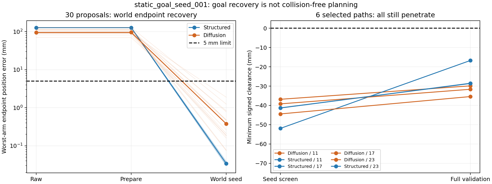

# P1 五障碍公开初始化与完整323修正：实际结果

2026-10-22；运行 `artifacts/v7_1/static_goal_seed_001`；生产入口提交 `2d0a4d4b`。

**世界目标初始化得到明显改善，但五障碍可执行路径仍未产生。** 30条提案在种子传播网格上全部达到原世界位姿门；预选的6条经精细完整验证后仍全部穿透。没有真实力矩执行，没有新训练或新数据。不能把这轮写成五障碍工程通过或Diffusion优势。

原worker终态保留`FAILED`：6个规划单元都已完成、账本无未决工作，最后只读审计将JSON列表当NumPy数组索引而抛出TypeError。新辅助版本仅转换保存的数组并重建代数证据，没有重跑规划或物理。恢复审计141/141通过；这不覆盖原故障，也不把负物理结果改为通过。

## 实际范围与来源

使用原固定五障碍任务、完整初态与世界目标，任务hash为`e66384242aaacf174ab1d7e642f0ba84b55ea580ab1b62951988409c75115496`。三种子20264611/17/23，两方法各5提案，共30条；每单元依冻结排序选1条，共6条完整323修正/验证，另24条仅初筛。未读取旧00/07已知合格控制路径作为部署答案。

本轮Diffusion实际调用旧102维网络240次（15条×16步），映射到完整323维并保留221细节自由度；网络65维条件不含完整障碍信息。共同世界初始化使用17个全路径平滑方向和真实自由漂浮传播；随后两法使用同一323避障修正器、预算、资格保持prepare及原验收门。没有新训练。

176份实际源码和86份输入与冻结manifest一致。**复现应使用运行内`executed_source.zip`及`run.json`，不能只checkout生产提交。** 其中`v6_lite/hierarchical_qp.py`包含启动前已存在的用户修改，归档保存了实际执行版本；本轮未覆盖或提交该用户文件。独立审查对“所有源码等于Git树”的额外检查为否，对归档/冻结身份一致性的检查为真。

## 分层结果

以下位置值均取每条轨迹双臂中的较大值；种子结果不是全路径资格。

|指标|结构几何提案|Diffusion提案|
|---|---:|---:|
|实际提案数|15|15|
|原始提案世界位姿通过|0/15|0/15|
|prepare后世界位姿通过|0/15|0/15|
|世界初始化后位姿通过|15/15|15/15|
|初始化后位置中位数 / P95 / 最坏（mm）|0.0340 / 0.0382 / 0.0398|0.3786 / 1.4439 / 1.8939|
|初始化后姿态最坏（°）|0.00170|0.08287|
|初筛不穿透|0/15|0/15|
|完整精细验证|3|3|
|完整验证位姿通过|3/3|3/3|
|完整验证MODEL_VALID|0/3|0/3|
|仅初筛、未完整验证|12|12|
|实际力矩执行 / 预定机会|0/3|0/3|
|本轮EXECUTION_VERIFIED|0|0|

模型合格产出为0/30提案；这与“30条均完成全部物理验证并失败”不同，后者不成立。实际执行次数为0，因此不能报告“执行成功率0/6”；应报告6个预选机会因模型层碰撞阻断、没有执行样本。



## 六条完整验证及配对结果

|种子|方法|最后位置误差（mm）|最后姿态误差（°）|最小有符号间隙（mm）|修正轮数 / 接受|
|---|---|---:|---:|---:|---:|
|20264611|结构|5.000000|0.999492|−16.7001|24 / 23|
|20264611|Diffusion|4.998847|0.999825|−29.8694|9 / 8|
|20264617|结构|4.999817|0.999953|−28.6307|14 / 13|
|20264617|Diffusion|4.980973|0.999943|−35.4207|8 / 5|
|20264623|结构|4.999365|0.999741|−28.5211|17 / 16|
|20264623|Diffusion|4.999828|0.999983|−31.6372|12 / 11|

首行位置按6位小数显示5.000000，实际保存值4.999999880429409mm，仍在原门内。原始精度数据保存在`evidence/statistics.json`及逐候选CSV，不用四舍五入改判。

六条最终都仅几何门失败，数值传播收敛与几何细分门通过；最大几何步长1.315–1.837mm。最差碰撞都发生在`v7_capture_3`障碍与刚性前臂`fore_arm_link/collision_0069`。Diffusion相对结构的最终间隙差分别为−13.1693、−6.7900、−3.1161mm，三对都更差。两法均无合格路径，不能用接近门边界的微小位置差声称Diffusion优势。

## 瓶颈判断

1. **原先的世界目标初始化不足已在本轮得到局部解决。** 91次目标迭代/91次接受试探，使30条种子的最大位置误差由约70.6–128.9mm降到不超过1.894mm。改善来自共同非线性世界修正，不能归给网络。
2. **避障阶段消耗了终点余量，却未走出穿透区域。** 84轮323修正中76轮接受，最终六条都停在`MINIMUM_TRUST_NO_ACCEPTED_STEP`。终点靠近5mm/1°约束边界，间隙仍为−16.7至−35.4mm。冻结预算未耗尽，不能解释为仅运行时间不足。
3. **局部求解不是全局绕行证明。** 84次SLSQP调用只有1次返回success标志；84次都有线性可行的候选增量，并由非线性试探决定是否接受。故只能确认本次局部机制未找到路径，不能称其达到全局最优，也不能宣布原场景无解。
4. **网络提案没有足够的环境条件，且共同修正占主导。** 静态65维条件不能让网络对未输入的障碍主动选择绕行。已有07见证说明该任务存在一条可表示且可执行路径，但它是开发见证，不能替代公开输入自主生成，更不能放进TRAIN。

据此不再追加同瓶颈步长/rank/学习率试验，也不因效果差追加训练或扩库。本轮消耗了路线允许的唯一五障碍机制修复机会。下一步转P4接口与固定开发套件，明确保留“五障碍公开规划”和“五障碍接近→动态追踪”两项缺口；不将三障碍组合换名冒充五障碍完成。

## 软件、审计与资源

- 启动前18项软件检查通过；它们不等于物理执行证明。
- 实际29202次耦合、18298744积分区间，0原生力矩步、0独立重放步，worker2585.422秒（43.09分钟），输出670483630字节；均在冻结上限内。
- 冻结审计原错误是`pose_vector(trial['ee'], ...)`对JSON列表使用元组索引。`tools/audit_saved_results_v1.py`修复读取类型，未改冻结源。
- 辅助审计首次用不同BLAS线程环境，3项DLS重建出现1.7–2.55e−10rad差异；原始结果保留在`raw_audit_recovered_v1.json`。按照worker原2线程重建后差为0，141/141通过；未调容差或物理门。见`algebra_environment_diagnosis.json`。
- 对原FAILED运行只做了一次resume拒绝验证：返回1并明确拒绝重放未知工作；前后1254文件清单/hash不变。此项是失败安全性通过，不是“原run完成成功”。不得再次resume。
- 新独立review保存在`paper/review-traces/experiment-result-to-claim/20261022_static_goal_seed_run01/`；原始重建5326/5327检查为真，唯一为否项是额外的Git树一致性检查，上述实际归档身份一致。整体/C1/正向C2均为no，confidence为high；终点初始化子结论yes，允许继续独立P4工作。缺PAPER_CLAIM_AUDIT，论文主张仍为provisional。

仅不穿透、世界5mm/1°、2mm几何步长、全初态、17→67、自由漂浮、全机几何与全部运动/力矩/重放门保持。新执行接口显式增加完整INTEGRATION重放检查，但本轮未进入执行，不能宣称该接口已由物理实验验证。未扩库、未TEST，旧结果和模型保留。

## 当前交付与推进

软件规划部分实际完成30提案和6完整验证；末尾审计软件错误已通过独立只读辅助版本收尾。数据资格新增0，真实执行新增0，Diffusion优势未建立。长期工程目标尚未完成。

终端使用只读统一入口：

```powershell
.\ff_prior_fullchain\job.ps1 status
.\ff_prior_fullchain\job.ps1 next
.\ff_prior_fullchain\job.ps1 report
```

证据：`evidence/candidate_layers.csv`、`statistics.json`、`repair_iterations.json`、`raw_audit_recovered_v2.json`、`completed_resume.json`；完整失败日志、控制点和传播位姿继续保存在原run，不提交大数据。
