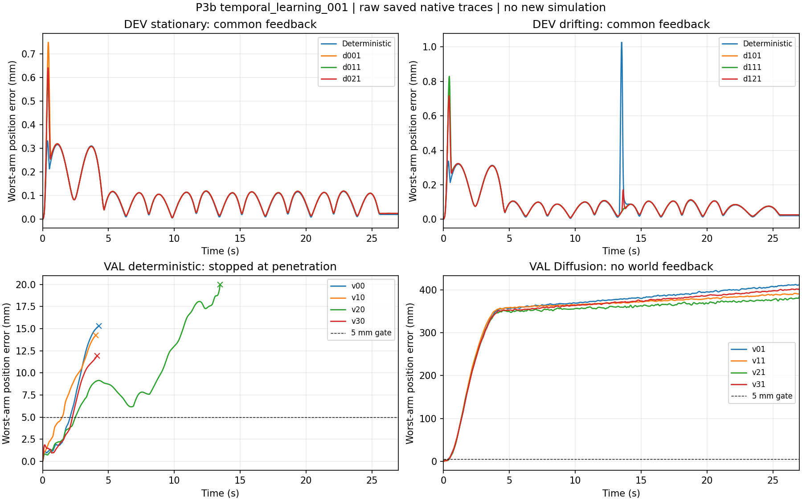

# P3b完整时序学习：动态反馈执行闭合，无引导生成仍不合格

2026-10-22。运行 `artifacts/v7_1/temporal_learning_001`，冻结源码 `681965a0`。后台已结束，状态 `FINISHED_WITH_BLOCKED_ITEMS`，worker墙钟 **820.125秒（13.67分钟）**。两个模型各实际训练3000次，共同世界反馈下的原两个动态DEV任务均通过；四个无世界反馈VAL任务，两种模型均未通过。长期工程目标仍未完成，五障碍自主规划及完整组合交接需要继续。

## 实际训练与数据边界

固定既有8TRAIN/4VAL，未新增数据；上一阶段4历史复用+8新执行取得的资格仍是来源资格，不是本轮新增数据成果。其余28条旧来源没有参与训练或升级。DEV和旧07路径未进入codec、梯度、模型选择。

新公共输入包括1014维完整初态/障碍/目标运动/时间条件，以及271×36逐时刻公开目标参考。输出为273×17的27秒C2样条，其中前两个控制量由初态固定，余4607个自由输出。确定性与Diffusion均为175361参数时序卷积网络，使用相同初始权重。不是Transformer与MLP优劣实验，也没有修改旧静态323模型。

|训练实测|确定性序列|时序Diffusion|
|---|---:|---:|
|32次临时诊断前→后完整采样损失|0.972310→0.945663|1.919031→1.872397|
|正式更新|3000|3000|
|每条TRAIN普通批次消费|3000|3000|
|正式完整输出监督样本次数|24000|1500（750次事件×2）|
|最终固定TRAIN完整采样损失|0.00102214|0.28265318|

诊断后权重全部恢复，再从原相同初始权重正式训练。保存的最终优化器step为3000，权重改变且重载一致；正式阶段及最后探针的网络调用分别3001和15016。checkpoint的consumed仅计普通批次；Diffusion每条TRAIN另参与187或188次完整输出监督，正式目标暴露合计25500，确定性为24000。诊断每方法另有256次临时样本暴露，权重已恢复。两方法数据顺序/批次摘要相同，但确定性模型不消费扩散噪声，训练目标与完整采样监督次数也不同，不能称训练计算或总监督消费完全相等。训练函数总耗时141.86秒，包含诊断。

损失是**合格全时域轨迹系数重建＋相邻差分误差**；它不是当前预测的非线性自由漂浮世界误差梯度。单位是归一化系数损失，不能转换成毫米通过率。8条小型TRAIN上的重建也不证明跨任务泛化。codec含TRAIN平均轨迹，平均轨迹与反馈控制的贡献均须保留。

## 全部分母、执行与重放

|评价层|确定性序列|时序Diffusion|
|---|---:|---:|
|VAL完整无世界引导候选|4|4|
|VAL执行合格|0/4|0/4|
|DEV共同反馈逻辑合格|6/6|6/6|
|DEV独特新执行合格|2/2|6/6|

共16条独特新实际执行，8通过、8失败；DEV确定性同任务的另四个种子位置共享已执行记录，**不是四次新执行或独立重复**。所有16条已观测轨迹的836维完整状态与独立力矩重放逐元素相同，包含失败的短轨迹；重放复现失败不等于任务通过。

实际原生174967步、重放174967步，合计349934≤432000。四条确定性VAL在穿透后提前终止，后续未观测部分不能填成成功或与完整27秒曲线直接等价。原模型、结果、用户修改、仅不穿透/5mm/1°/2mm几何步长和全部原运动/力矩门保留。没有训练库写入、扩库或TEST。

## 无引导VAL为什么失败

“无引导”指没有世界目标反馈及避障修正，仍有原生力矩关节参考跟踪。raw输出和prepare均保存；raw未做额外物理执行，不能给raw臆造世界命中率。

|VAL任务|确定性：观测时长/位置最坏mm|Diffusion：27秒位置最坏mm|Diffusion prepare比例|
|---|---:|---:|---:|
|v0|4.266秒 / 15.304|412.521|0.06834|
|v1|4.048秒 / 14.269|391.915|0.05038|
|v2|13.476秒 / 19.997|383.838|0.07781|
|v3|4.144秒 / 11.936|402.082|0.05941|

位置取每个已观测时刻双臂较大值再取全程最大。确定性四条均因穿透提前停止；位置均越门，其中v2姿态也越门。其prepare逐元素不变，原始参考加速度凸包峰值仅0.776–0.833倍限值，说明它的主要问题是小样本条件泛化/世界路径偏差，而不是本轮prepare收缩。

Diffusion四条均跑完27秒，但位置、姿态、实际运动约束均未通过。其原始加速度凸包峰值达原限值 **12.85–19.85倍**，速度峰值约2.14–2.48倍。全序列统一prepare为了合规，向初态常值轨迹缩小到5.04%–7.78%，连原本需要完成的主运动也一起缩掉。仅从保存系数计算，raw对合格VAL标签的归一化MSE为0.560–1.672，prepare后反而升至97.340–103.171。这个代数证据直接支持“参考导数修复损坏运动幅度”的判断；不等于raw本来已满足世界门。

完整输出监督虽已接通，当前差分损失仍不能保证0.1秒密集控制量的物理加速度。二阶时间变化会放大小的相邻系数误差，单一幅度收缩因此成为主要失真来源。prepare只保证参考运动合同，不检查世界目标/碰撞，也没有给实际控制响应留下充分余量：参考加速度接近0.9999999倍限值，独立代数核对的实际低层加速度峰值为1.001681–1.003133倍原限，每条各一个步超限；v01/v11/v31发生在27秒，v21发生在12.1秒。最终验收正确保留了这些失败，没有按“数值很小”追认通过；这也不能保证仅缩小scale就能解决目标精度问题。

不能把这一轮归结为微重力建模失效。现有直接证据是小样本重建/泛化不足、时间细节误差、prepare整幅收缩和实际响应限值问题；DDIM数值与源身份的独立核查见审查记录。扩库本身不能直接修复上述表示和部署变换失配。

## 原冻结DEV：共同反馈有效，收益有场景差异

两种方法使用相同公开任务、相同共同世界反馈、原运动/避障滤波及真实力矩控制；没有加载已知答案作为回退。误差统计覆盖完整27秒。以下均为双臂较大位置误差，单位mm：

|任务/方法|时间均值|时间P95|全程最坏|
|---|---:|---:|---:|
|静止 / 确定性（共享三个配对）|0.09689|0.28943|0.33274|
|静止 / Diffusion种子1|0.10204|0.29741|0.75038|
|静止 / Diffusion种子2|0.10059|0.29543|0.60854|
|静止 / Diffusion种子3|0.10083|0.29577|0.64207|
|漂移 / 确定性（共享三个配对）|0.09544|0.29952|1.03450|
|漂移 / Diffusion种子1|0.09392|0.29960|0.75369|
|漂移 / Diffusion种子2|0.09474|0.30060|0.83198|
|漂移 / Diffusion种子3|0.09395|0.29931|0.71739|

静止任务三个Diffusion种子的位置均值/P95/最坏均高于确定性；漂移任务均值和最坏均降低，但P95并非全部降低。逻辑六单位最坏位置的均值为确定性0.68362mm、Diffusion0.71734mm；最大值为1.03450→0.83198mm。所有物理执行均通过，成功率相同，不存在成功率胜出证据。

姿态也需分场景：静止确定性最坏0.001736°，Diffusion为0.001472–0.002380°；漂移确定性0.011110°，Diffusion为0.002108–0.002444°。这支持该漂移任务的局部尾部改善，不支持稳定跨任务优势或未见任务泛化。两个任务×三噪声不是六个独立任务，不做不适当显著性外推。

DEV的prepare仍明显收缩（确定性约22.1%–22.3%，Diffusion2.75%–5.63%）。共同世界反馈的速度修正范数均值约0.58–0.60rad/s和0.71–0.75rad/s，已经与模型给出的preferred速度范数同量级。这说明完整成功需要实质性的反馈修正，不能包装成“网络自主完成动态避障追踪”。TRAIN/VAL含两个球形外障碍、grasp_local的y=-0.205m；原DEV无外加障碍、该y=-0.235m，且运动域不同。不能把两者0/4→6/6当作同一任务上的控制消融，也不能据此证明新模型已掌握有外障碍的动态避障；控制贡献证据来自实际更新公式和保存的修正量。



曲线以保存的原生状态计算，下方确定性曲线的叉号是实际停止点，未延长失败轨迹；CSV逐单位结果见 `../evidence/unit_metrics.csv`。

## 收尾、可复现命令与下一阶段

新的[独立审查](../../paper/review-traces/experiment-result-to-claim/20261022_temporal_learning_run01/review.md)已完成：**overall partial/high，局部C1 yes，跨场景统一C2 no**。178源码、369输入、8TRAIN-only codec、临时更新恢复、实际正式优化器/消费摘要、16DDIM输出、全部16执行/836状态重放及保存数组物理门共1334项核对，0不一致。未新增物理、几何查询或optimizer更新，缺PAPER_CLAIM_AUDIT，论文写作结论保持provisional。

审查还发现未来验收代码需补强：旧evaluate虽然保存完整836维重放差，接受门只检查qpos/qvel。本run全部完整差值确为0，故不撤销本run结果；下一新版本应把完整状态差显式纳入门。冻结源码不原地修改或重跑。

主统计来自保存数组，见 `ff_prior_temporal_learning/evidence/completed_statistics.json`。一次完成resume已完成：exit0、`NO_WORK_ALREADY_COMPLETE`，前后278个文件清单/hash完全相同；禁止再次resume补验证。最终输出1,922,372,136字节；与P3a合计墙钟1197.578秒、输出约3.075GB，均在原P3预算内。输出体积不是峰值RAM测量，本轮也未证明实时部署时延。

本轮软件实现与真实训练完成；既有数据资格不变；八条新DEV执行达到EXECUTION_VERIFIED，八条VAL失败不能升级；Diffusion相对收益仅局部描述、整体稳定优势未建立。裸提案不能仅因通过prepare被称为MODEL_VALID。

按持续路线转向P1原五障碍的唯一机制修复，再进行P4固定整链验收，不因科学优势未成立再训练这个候选。P1现有证据表明公开一步初始化终点仍差约128mm，原弓形在终点为零；需要在原剩余预算内先解决公开初态到固定世界目标的非线性可行初始化，再接几何绕行与323修正。不得加载旧07答案、不改变原目标或物理门。具体代码、种子和预算另冻后才运行；不能把本段建议写成已执行。

```powershell
.\ff_prior_fullchain\job.ps1 status
.\ff_prior_fullchain\job.ps1 next
.\ff_prior_temporal_learning\job.ps1 report
```

本轮只是动态学习/执行阶段收尾；五障碍自主路径、组合任务和可复现整链交付尚未完成，长期目标保持active，最终TEST保持未启动。
